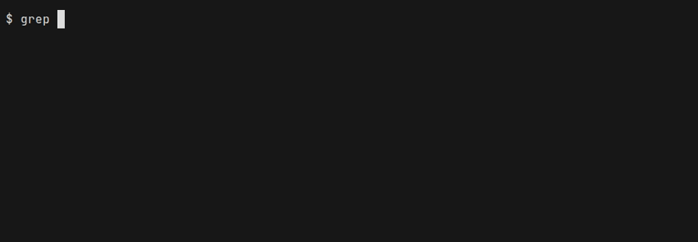

# Nesso

[](https://github.com/lorenzocaprari/nesso/actions/workflows/ci.yml)
[](https://github.com/lorenzocaprari/nesso/actions/workflows/ci.yml?query=event%3Aschedule+branch%3Amain)
[](https://github.com/lorenzocaprari/nesso/releases/latest)
[](LICENSE)
[](https://scorecard.dev/viewer/?uri=github.com/lorenzocaprari/nesso)
[](https://www.bestpractices.dev/projects/15392)
[](https://slsa.dev)
[](https://github.com/lorenzocaprari/nesso/actions/workflows/codeql.yml)
[](https://github.com/lorenzocaprari/nesso/actions/workflows/cifuzz.yml)
[](https://github.com/lorenzocaprari/nesso/pkgs/container/nesso)
[](https://codecov.io/gh/lorenzocaprari/nesso)

grep for meaning: find the log lines you're looking for even when the words differ. Offline, one binary.

Semantic grep for logs, fully offline, no server, no cloud, no API keys, [Apache-2.0](LICENSE).

## Demo



The log does not contain the query.

```bash
nesso grep "the disk is full" app.log -k 3
```

```text
line 869: 0.4736: Oct 18 06:13:11 web-02 app[4900]: write /var/lib/app/queue.db: No space left on device
line 1494: 0.4694: Oct 22 17:08:04 web-02 app[7918]: write /var/lib/app/queue.db: No space left on device
line 3762: 0.4677: Oct 24 23:39:07 web-02 app[2888]: write /var/lib/app/queue.db: No space left on device
```

```bash
nesso index -o app.nesso app.log
```

```text
Indexed 5000 chunks into 'app.nesso'.
```

```bash
nesso search "the disk is full" -i app.nesso -k 3
```

```text
line 869: 0.4736: Oct 18 06:13:11 web-02 app[4900]: write /var/lib/app/queue.db: No space left on device
line 1494: 0.4694: Oct 22 17:08:04 web-02 app[7918]: write /var/lib/app/queue.db: No space left on device
line 3762: 0.4677: Oct 24 23:39:07 web-02 app[2888]: write /var/lib/app/queue.db: No space left on device
```

## Install

Ubuntu 26.04+ (glibc 2.43+), amd64. The package includes the MiniLM model.

```bash
curl -fL -o nesso_0.2.1_amd64.deb \
  https://github.com/lorenzocaprari/nesso/releases/download/v0.2.1/nesso_0.2.1_amd64.deb
sudo apt install ./nesso_0.2.1_amd64.deb
```

## Verify a download

`nesso_0.2.1.intoto.jsonl` covers the `.deb` packages and the SPDX SBOMs. `SHA256SUMS` lists every release file. The image attestation is stored on the manifest-list digest in GHCR.

```bash
curl -fL -o nesso_0.2.1_amd64.deb \
  https://github.com/lorenzocaprari/nesso/releases/download/v0.2.1/nesso_0.2.1_amd64.deb
curl -fL -o nesso_0.2.1.intoto.jsonl \
  https://github.com/lorenzocaprari/nesso/releases/download/v0.2.1/nesso_0.2.1.intoto.jsonl
curl -fL -o SHA256SUMS \
  https://github.com/lorenzocaprari/nesso/releases/download/v0.2.1/SHA256SUMS

sha256sum --ignore-missing -c SHA256SUMS

slsa-verifier verify-artifact nesso_0.2.1_amd64.deb \
  --provenance-path nesso_0.2.1.intoto.jsonl \
  --source-uri github.com/lorenzocaprari/nesso \
  --source-tag v0.2.1

digest="$(docker buildx imagetools inspect --format '{{index .Manifest.Digest}}' ghcr.io/lorenzocaprari/nesso:v0.2.1)"
slsa-verifier verify-image "ghcr.io/lorenzocaprari/nesso@${digest}" \
  --source-uri github.com/lorenzocaprari/nesso \
  --source-tag v0.2.1
```

`slsa-verifier` v2.7.1 or later. Signatures and the other provenance files are in [Verifying a release](docs/verifying.md).

## More

- [Usage](docs/usage.md)
- [Building](docs/building.md)
- [Releases](docs/releases.md)
- [Verifying a release](docs/verifying.md) (from v0.2.0)
- [Benchmarks](docs/benchmarks.md)
- [Determinism](docs/determinism.md)
- [Decisions](docs/adr/README.md)
- [Changelog](CHANGELOG.md), [contributing](CONTRIBUTING.md), [security](SECURITY.md), [license](LICENSE)
