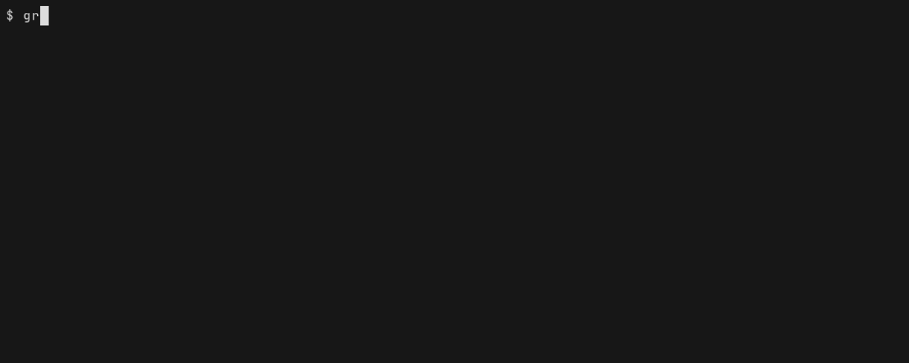

<h1 align="center">
  <picture>
    <source media="(prefers-color-scheme: dark)" srcset="docs/assets/nesso-logo-dark.svg">
    
  </picture>
</h1>

> *nesso* (/ˈnɛs.so/, NESS-oh) is Italian for "link, connection" — it finds the connection between log lines by meaning, not just by keyword.

[](https://github.com/lorenzocaprari/nesso/actions/workflows/ci.yml)
[](https://github.com/lorenzocaprari/nesso/actions/workflows/ci.yml?query=event%3Aschedule+branch%3Amain)
[](https://github.com/lorenzocaprari/nesso/releases/latest)
[](LICENSE)
[](https://scorecard.dev/viewer/?uri=github.com/lorenzocaprari/nesso)
[](https://www.bestpractices.dev/projects/15392)
[](https://slsa.dev)
[](https://github.com/lorenzocaprari/nesso/actions/workflows/codeql.yml)
[](https://github.com/lorenzocaprari/nesso/actions/workflows/cifuzz.yml)
[](https://github.com/lorenzocaprari/nesso/pkgs/container/nesso)
[](https://codecov.io/gh/lorenzocaprari/nesso)

Semantic search for local logs: find a line by meaning when the words differ. Offline, one binary, no server, no cloud call, and no API key. [Apache-2.0](LICENSE).

Support engineers: [triage a sosreport or tarball](docs/quick-start.md). Piping the matches is in that page's [shell output](docs/quick-start.md#shell-output) section.

## Demo



The log does not contain the query. A plain `grep` finds nothing; `nesso grep` matches by meaning. Index once, then `nesso search` for more queries on the same corpus. Sosreport/tar/zip and `--json` are in the [quick start](docs/quick-start.md).

```bash
grep -c 'the disk is full' app.log
```

```text
0
```

```bash
nesso grep "the disk is full" app.log
```

```text
line 151: 3.4186: Oct 11 04:43:02 web-02 app[4389]: write /var/lib/app/queue.db: No space left on device
line 183: 3.4186: Oct 15 01:56:49 web-01 app[9813]: write /var/lib/app/queue.db: No space left on device
line 268: 3.4186: Oct 12 23:12:36 web-02 app[3833]: write /var/lib/app/queue.db: No space left on device
line 301: 3.4186: Oct 24 23:33:21 web-01 app[6365]: write /var/lib/app/queue.db: No space left on device
line 552: 3.4186: Oct  7 05:07:28 web-02 app[7872]: write /var/lib/app/queue.db: No space left on device
```

```bash
nesso index -o app.nesso app.log
```

```text
Indexed 5000 chunks into 'app.nesso'.
```

```bash
nesso search "the disk is full" -i app.nesso
```

```text
line 151: 3.4186: Oct 11 04:43:02 web-02 app[4389]: write /var/lib/app/queue.db: No space left on device
line 183: 3.4186: Oct 15 01:56:49 web-01 app[9813]: write /var/lib/app/queue.db: No space left on device
line 268: 3.4186: Oct 12 23:12:36 web-02 app[3833]: write /var/lib/app/queue.db: No space left on device
line 301: 3.4186: Oct 24 23:33:21 web-01 app[6365]: write /var/lib/app/queue.db: No space left on device
line 552: 3.4186: Oct  7 05:07:28 web-02 app[7872]: write /var/lib/app/queue.db: No space left on device
```

`--json` on `grep` and `search` prints one JSON object per match instead of these text lines. The keys, and how to pipe them, are in the quick start's [shell output](docs/quick-start.md#shell-output) section. `index` does not accept `--json`. `grep` and `search` default to `--mode auto`.

## Install

Ubuntu 22.04+, Debian 12+, and RHEL/Rocky 9, amd64/x86_64 or arm64/aarch64. The `.deb` and `.rpm` install `/usr/bin/nesso` and the MiniLM files in `/usr/share/nesso`.

```bash
curl -fL -o nesso_0.3.0_amd64.deb \
  https://github.com/lorenzocaprari/nesso/releases/download/v0.3.0/nesso_0.3.0_amd64.deb
sudo apt install ./nesso_0.3.0_amd64.deb

curl -fL -o nesso_0.3.0_arm64.deb \
  https://github.com/lorenzocaprari/nesso/releases/download/v0.3.0/nesso_0.3.0_arm64.deb
sudo apt install ./nesso_0.3.0_arm64.deb

curl -fL -o nesso-0.3.0-1.x86_64.rpm \
  https://github.com/lorenzocaprari/nesso/releases/download/v0.3.0/nesso-0.3.0-1.x86_64.rpm
sudo dnf install ./nesso-0.3.0-1.x86_64.rpm

curl -fL -o nesso-0.3.0-1.aarch64.rpm \
  https://github.com/lorenzocaprari/nesso/releases/download/v0.3.0/nesso-0.3.0-1.aarch64.rpm
sudo dnf install ./nesso-0.3.0-1.aarch64.rpm
```

The tags `v0.3.0`, `0.3.0`, and `latest` on `ghcr.io/lorenzocaprari/nesso` are one manifest list (`linux/amd64` and `linux/arm64`). The image stores the model at `/usr/share/nesso` and sets `NESSO_MODEL_DIR` to that directory. The entrypoint is `nesso` (`/usr/local/bin/nesso`). Mount the log directory:

```bash
docker run --rm -v "$PWD:/data:ro" -w /data ghcr.io/lorenzocaprari/nesso:v0.3.0 \
  grep "the disk is full" app.log
```

## Verify a download

`nesso_0.3.0.intoto.jsonl` covers the `.deb` packages, the `.rpm` packages, and the SPDX SBOMs. `SHA256SUMS` lists every release file. The image attestation is stored on the manifest-list digest in GHCR.

```bash
curl -fL -o nesso_0.3.0_amd64.deb \
  https://github.com/lorenzocaprari/nesso/releases/download/v0.3.0/nesso_0.3.0_amd64.deb
curl -fL -o nesso_0.3.0.intoto.jsonl \
  https://github.com/lorenzocaprari/nesso/releases/download/v0.3.0/nesso_0.3.0.intoto.jsonl
curl -fL -o SHA256SUMS \
  https://github.com/lorenzocaprari/nesso/releases/download/v0.3.0/SHA256SUMS

sha256sum --ignore-missing -c SHA256SUMS

slsa-verifier verify-artifact nesso_0.3.0_amd64.deb \
  --provenance-path nesso_0.3.0.intoto.jsonl \
  --source-uri github.com/lorenzocaprari/nesso \
  --source-tag v0.3.0

digest="$(docker buildx imagetools inspect --format '{{index .Manifest.Digest}}' ghcr.io/lorenzocaprari/nesso:v0.3.0)"
slsa-verifier verify-image "ghcr.io/lorenzocaprari/nesso@${digest}" \
  --source-uri github.com/lorenzocaprari/nesso \
  --source-tag v0.3.0
```

`slsa-verifier` v2.7.1 or later. Signatures and the other provenance files are in [Verifying a release](docs/verifying.md).

## Build

Linux, GCC 15 or newer, CMake 4.2 or newer, and Conan 2. The local Release profile is `conan/profiles/gcc-26-dev`:

```bash
conan install . -pr:h ./conan/profiles/gcc-26-dev -pr:b default \
  --lockfile=conan.lock --build=missing
conan build . -pr:h ./conan/profiles/gcc-26-dev -pr:b default \
  --lockfile=conan.lock --build=missing
./scripts/fetch-model
```

The binary is `build/Release/src/nesso`. A Debug build writes `build/Debug/src/nesso`. Inside the `nesso-build-env` image, add `--no-remote` on both Conan commands. The other profiles are in [Building](docs/building.md).

## More

- [Quick start](docs/quick-start.md)
- [Usage](docs/usage.md)
- [Building](docs/building.md)
- [Releases](docs/releases.md)
- [Verifying a release](docs/verifying.md) (from v0.2.0)
- [Benchmarks](docs/benchmarks.md)
- [Determinism](docs/determinism.md)
- [Decisions](docs/adr/README.md)
- [Changelog](CHANGELOG.md), [contributing](CONTRIBUTING.md), [security](SECURITY.md), [license](LICENSE)
